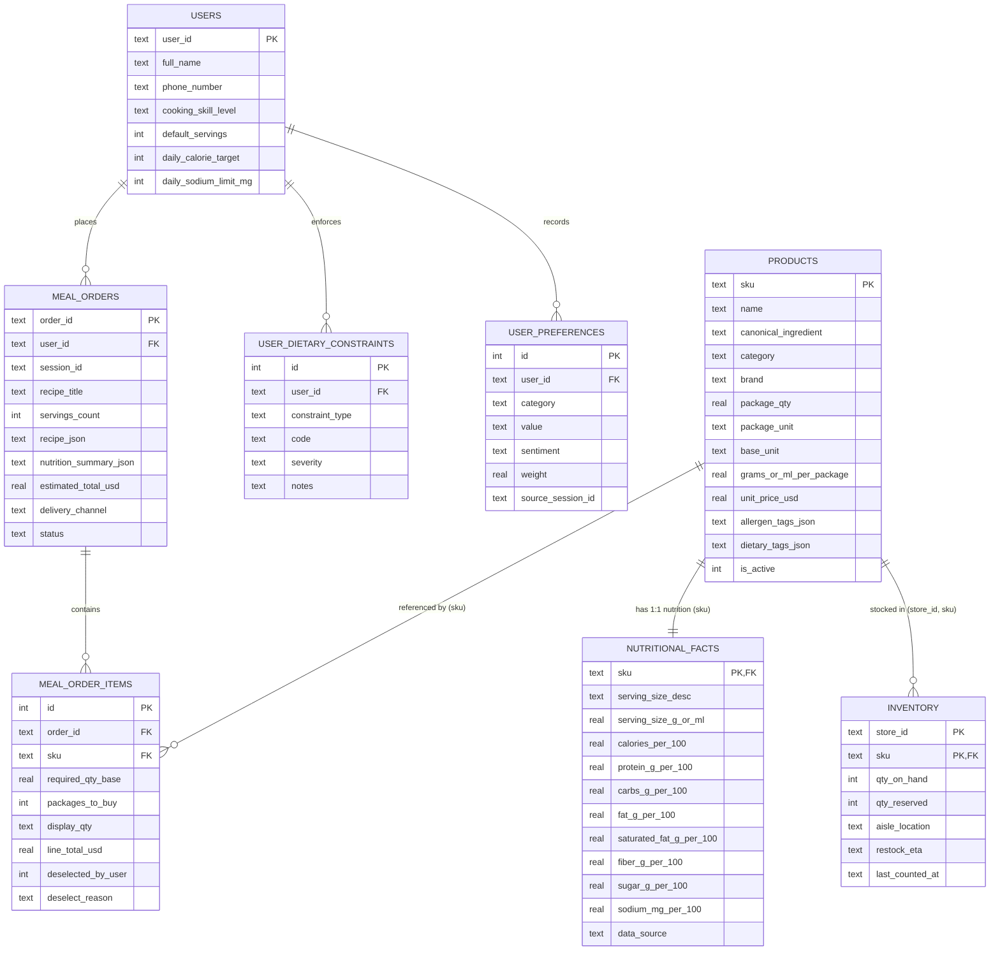
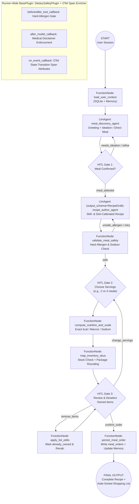

# Recipe Planner & Shopping List Agent — ADK 2.0 Design Document

> **Status:** Draft for Review (Pre-Implementation)
> **Framework:** Google Agent Development Kit (ADK) 2.0 (`google.adk.workflow.Workflow`) + `agents-cli`
> **Target Environment:** Local Prototype (`--prototype`) with SQLite & Local OpenTelemetry (Cloud-Ready via `agents-cli scaffold enhance`)

---

## 1. Executive Summary

This document proposes an end-to-end architecture for a hypothetical grocery store's **Recipe Planner & Shopping List Agent** built on **Google ADK 2.0**. The design prioritizes **deterministic tool execution** for all factual, mathematical, dietary-safety, and inventory operations, reserving LLM calls strictly for natural conversation, meal ideation, and skill-calibrated recipe authoring.

It covers:
1. **Proposed Database Schemas** (SQLite) across all 5 store/user domains.
2. **Agentic Workflow DAG & Data-Flow Diagrams** (ADK 2.0 `Workflow` + HITL gates).
3. **Deep-Dive Proposals for the 5 Core Areas:**
   - Area 1: Tool and Interface Design
   - Area 2: Orchestration and Logic
   - Area 3: Context and Memory
   - Area 4: Observability and Tracing
   - Area 5: Infrastructure and CI/CD
4. **UX Enhancements & Implementation Roadmap.**

---

## 2. Proposed Database Schemas (SQLite)

Before seeding data, we propose the following normalized SQLite schema (`data/grocery_store.db`). All monetary, mass, volume, and nutritional values use normalized base units (`g`, `ml`, `count`) so deterministic tools never rely on fragile LLM unit conversions.

### Entity-Relationship Diagram



### 2.1 Product Catalogue (`products`)
Stores every purchasable SKU, its canonical ingredient key (for deterministic recipe-to-SKU mapping), package sizing, pricing, and structured allergen/dietary tags.

```sql
CREATE TABLE products (
    sku                     TEXT PRIMARY KEY,              -- e.g. 'SKU-CHK-BRST-16OZ'
    name                    TEXT NOT NULL,                 -- 'Organic Boneless Skinless Chicken Breast'
    canonical_ingredient    TEXT NOT NULL,                 -- 'chicken_breast'
    category                TEXT NOT NULL,                 -- 'meat_poultry', 'produce', 'spices', ...
    brand                   TEXT,
    package_qty             REAL NOT NULL,                 -- 1.0 (display unit qty)
    package_unit            TEXT NOT NULL,                 -- 'lb', 'oz', 'count', 'bottle'
    base_unit               TEXT NOT NULL CHECK (base_unit IN ('g', 'ml', 'count')),
    grams_or_ml_per_package REAL NOT NULL,                 -- 453.592 (1 lb in grams)
    unit_price_usd          REAL NOT NULL,
    allergen_tags_json      TEXT NOT NULL DEFAULT '[]',    -- '["gluten","soy"]'
    dietary_tags_json       TEXT NOT NULL DEFAULT '[]',    -- '["gluten_free","low_sodium"]'
    is_active               INTEGER NOT NULL DEFAULT 1,
    updated_at              TEXT NOT NULL
);
CREATE INDEX idx_products_canonical ON products(canonical_ingredient);
```

### 2.2 Nutritional Facts (`nutritional_facts`)
1:1 with `products.sku`. Normalized per 100g / 100ml (or per `count` for discrete produce like eggs/peppers via `serving_size_g_or_ml`) to guarantee exact deterministic calorie, macro, and sodium scaling.

```sql
CREATE TABLE nutritional_facts (
    sku                     TEXT PRIMARY KEY REFERENCES products(sku),
    serving_size_desc       TEXT NOT NULL,                 -- '4 oz (112g)'
    serving_size_g_or_ml    REAL NOT NULL,                 -- 112.0
    calories_per_100        REAL NOT NULL,
    protein_g_per_100       REAL NOT NULL,
    carbs_g_per_100         REAL NOT NULL,
    fat_g_per_100           REAL NOT NULL,
    saturated_fat_g_per_100 REAL NOT NULL,
    fiber_g_per_100         REAL NOT NULL,
    sugar_g_per_100         REAL NOT NULL,
    sodium_mg_per_100       REAL NOT NULL,                 -- Critical for hypertension checks
    data_source             TEXT NOT NULL DEFAULT 'USDA_FDC_SEED'
);
```

### 2.3 Inventory (`inventory` + `v_available_inventory`)
Tracks stock per store, reserved counts, and aisle locations (enabling aisle-sorted shopping lists).

```sql
CREATE TABLE inventory (
    store_id        TEXT NOT NULL DEFAULT 'STORE-001',
    sku             TEXT NOT NULL REFERENCES products(sku),
    qty_on_hand     INTEGER NOT NULL CHECK (qty_on_hand >= 0),
    qty_reserved    INTEGER NOT NULL DEFAULT 0 CHECK (qty_reserved >= 0),
    aisle_location  TEXT NOT NULL,                         -- 'Aisle 4 - Spices'
    restock_eta     TEXT,
    last_counted_at TEXT NOT NULL,
    PRIMARY KEY (store_id, sku)
);

CREATE VIEW v_available_inventory AS
SELECT store_id, sku, (qty_on_hand - qty_reserved) AS available_qty, aisle_location, restock_eta
FROM inventory;
```

### 2.4 User Information (`users`, `user_dietary_constraints`, `user_preferences`)
Separates **hard medical/allergen rules** (deterministic safety enforcement) from **soft taste/cuisine preferences** (ranking & personalization) and **cooking skill level**.

```sql
CREATE TABLE users (
    user_id               TEXT PRIMARY KEY,                -- 'cust_malcom_munson'
    full_name             TEXT NOT NULL,                   -- 'Malcom Munson'
    phone_number          TEXT,                            -- Future SMS delivery
    cooking_skill_level   TEXT NOT NULL DEFAULT 'intermediate'
                          CHECK (cooking_skill_level IN ('beginner', 'intermediate', 'advanced')),
    default_servings      INTEGER NOT NULL DEFAULT 2,
    daily_calorie_target  INTEGER,
    daily_sodium_limit_mg INTEGER,                         -- e.g. 1500 for high blood pressure
    created_at            TEXT NOT NULL,
    updated_at            TEXT NOT NULL
);

CREATE TABLE user_dietary_constraints (
    id              INTEGER PRIMARY KEY AUTOINCREMENT,
    user_id         TEXT NOT NULL REFERENCES users(user_id),
    constraint_type TEXT NOT NULL CHECK (constraint_type IN ('medical_condition', 'allergen', 'diet_regime')),
    code            TEXT NOT NULL,                         -- 'celiac_disease', 'gluten', 'hypertension', 'low_sodium'
    severity        TEXT NOT NULL CHECK (severity IN ('hard_block', 'warn_threshold')),
    notes           TEXT,
    UNIQUE(user_id, constraint_type, code)
);

CREATE TABLE user_preferences (
    id                INTEGER PRIMARY KEY AUTOINCREMENT,
    user_id           TEXT NOT NULL REFERENCES users(user_id),
    category          TEXT NOT NULL CHECK (category IN ('cuisine', 'ingredient', 'protein', 'flavor_profile', 'equipment')),
    value             TEXT NOT NULL,                       -- 'mediterranean', 'chicken', 'eggplant', 'spicy'
    sentiment         TEXT NOT NULL CHECK (sentiment IN ('like', 'prefer', 'dislike', 'avoid')),
    weight            REAL NOT NULL DEFAULT 1.0,
    source_session_id TEXT,
    updated_at        TEXT NOT NULL,
    UNIQUE(user_id, category, value)
);
```

### 2.5 Purchase / Finalized Shopping Lists (`meal_orders`, `meal_order_items`)
Stores finalized recipes and shopping lists attached to customer accounts, preserving an audit log of items deselected by the user (e.g., cumin powder already owned).

```sql
CREATE TABLE meal_orders (
    order_id               TEXT PRIMARY KEY,               -- UUIDv4
    user_id                TEXT NOT NULL REFERENCES users(user_id),
    session_id             TEXT NOT NULL,
    recipe_title           TEXT NOT NULL,
    servings_count         INTEGER NOT NULL,
    recipe_json            TEXT NOT NULL,
    nutrition_summary_json TEXT NOT NULL,
    estimated_total_usd    REAL NOT NULL,
    delivery_channel       TEXT NOT NULL DEFAULT 'account_attached',
    status                 TEXT NOT NULL DEFAULT 'finalized',
    created_at             TEXT NOT NULL
);

CREATE TABLE meal_order_items (
    id                 INTEGER PRIMARY KEY AUTOINCREMENT,
    order_id           TEXT NOT NULL REFERENCES meal_orders(order_id),
    sku                TEXT NOT NULL REFERENCES products(sku),
    required_qty_base  REAL NOT NULL,
    packages_to_buy    INTEGER NOT NULL,
    display_qty        TEXT NOT NULL,                      -- '1.5 lbs (2 x 1 lb packs)'
    line_total_usd     REAL NOT NULL,
    deselected_by_user INTEGER NOT NULL DEFAULT 0,
    deselect_reason    TEXT                                -- 'already_owned'
);
```

**Seed Data Plan:** ~100 realistic SKUs spanning Produce, Meat & Poultry, Seafood, Dairy, Grains/Pasta (including certified gluten-free options), Pantry/Sauces (including low-sodium tamari & broths), and Spices, plus a test fixture suite including **Malcom Munson** (`celiac_disease`/`gluten: hard_block`, `hypertension`/`low_sodium: warn_threshold`, likes Mediterranean, prefers chicken > fish, dislikes eggplant).

---

## 3. Agentic Workflow DAG & Data Flow (ADK 2.0)



---

## 4. Architecture Proposal Across the 5 Core Areas

### Area 1: Tool and Interface Design
- **Determinism-First Principle:** Every calculation, lookup, filter, and state mutation is implemented as a typed Python function with Pydantic I/O models (`IngredientSpec`, `RecipeDraft`, `NutritionSummary`, `ShoppingListItem`, `MealOrderReceipt`). LLMs never do arithmetic, unit conversions, allergen filtering, or price summing.
- **Tool Catalog (`app/tools/`):**
  - `profile_tools.py`: `get_user_profile`, `upsert_user_preference`, `set_cooking_skill_level`
  - `catalog_tools.py`: `search_products`, `find_safe_substitute_sku`
  - `nutrition_tools.py`: `get_sku_nutrition`, `calculate_recipe_nutrition`, `convert_units_to_base`
  - `safety_tools.py`: `check_dietary_compliance` (deterministic allergen intersection + sodium threshold check)
  - `shopping_tools.py`: `build_shopping_list`, `apply_deselections`, `save_meal_order`
- **User-Friendly & UI-Ready Interface:**
  - Every user-facing `FunctionNode` emits both structured JSON (`Event.output`, Pydantic-validated) AND human-readable Markdown (`Event.content` for `agents-cli playground` / ADK Web UI).
  - Shopping lists are automatically **grouped by `aisle_location`** and show both recipe amount and purchasable package count (e.g., `Chicken Breast — need 1.5 lbs → buy 2 × 1 lb packs ($11.98) [Meat Counter]`).
  - Because `Event.output` uses strict Pydantic contracts and `agents-cli` ships A2A support out of the box, a future React / **A2UI** frontend can render interactive item-deselection checkboxes and nutrition cards with zero backend rewrite.

### Area 2: Orchestration and Logic
- **ADK 2.0 Graph `Workflow`:** Uses `google.adk.workflow.Workflow` with explicit routed edges (`Event(output=..., route=..., state=...)`) rather than relying on fragile prompt-only transitions.
- **Explicit Resumable HITL Gates:** Configured via `App(name="app", root_agent=root_agent, resumability_config=ResumabilityConfig(is_resumable=True))`. Each gate uses `RequestInput(interrupt_id=f"<stage>_{iteration}", message=...)` with unique loop-safe `interrupt_id`s so users can iterate naturally:
  - *Gate 1 (Meal Selection)*: Blocks downstream nutrition/inventory execution until `selected_meal` is confirmed.
  - *Gate 2 (Serving Size)*: Captures `servings_count` (defaulting to user's stored `default_servings`, easily adjustable).
  - *Gate 3 (Shopping List Review)*: Allows deselecting owned items (e.g., `"I already have cumin powder and olive oil"`) or looping back to resize servings before checkout.
- **Self-Healing Safety Loop:** If `recipe_author_agent` proposes an ingredient whose matched SKU violates a `hard_block` allergen (e.g., wheat soy sauce for celiac), `validate_meal_safety` deterministically routes `"unsafe_allergen"` back to `recipe_author_agent` (capped at `max_attempts=3`) with exact violation details and safe in-stock substitutes.
- **Runner-Wide Guardrails (`DietarySafetyPlugin`):** Adapted from `core/python/safety-plugins`, wraps every agent and tool in one place to guarantee zero allergen leakage and consistent medical disclaimers.

### Area 3: Context and Memory
- **Three-Tier Memory Architecture (Restorable Across Sessions):**
  1. **Intra-Session Workflow State (`ctx.state` / `Event.state`)**: Holds active workflow progress (`stage`, `selected_meal`, `servings_count`, `draft_recipe`, `draft_shopping_list`), persisted across turns and restarts via ADK's **`DatabaseSessionService`** backed by local SQLite (`sqlite+aiosqlite:///data/adk_sessions.db`).
  2. **Structured Cross-Session User Profile (SQLite `users`, `user_dietary_constraints`, `user_preferences`)**: Source of truth for deterministic tools — hard medical constraints (`celiac_disease`, `hypertension`), allergen blocks, preferences (`mediterranean`, dislikes `eggplant`), and `cooking_skill_level`. Loaded at `START` into `user:*` state keys.
  3. **Episodic Long-Term Memory (`MemoryService` + `PreloadMemoryTool`)**: Adapted from `core/python/cross-session-memory`. An `after_agent_callback` persists conversational facts and past meal feedback (`add_session_to_memory`), and `PreloadMemoryTool` injects relevant past context at turn start. Local prototype uses an ADK `MemoryService` adapter backed by SQLite/in-memory; production GCP swaps cleanly to **Gemini platform Memory Bank** with zero agent logic changes.
- **Context Hygiene:** Uses ADK `EventsCompactionConfig` (token-threshold compaction) for long meal-planning sessions so prompt windows stay lean and deterministic state remains lossless.

### Area 4: Observability and Tracing
- **Native ADK OpenTelemetry Instrumentation:** ADK 2.0 emits hierarchical OpenTelemetry spans out of the box:
  ```text
  invoke_workflow (root meal_planner_workflow)
    ├── execute_node: load_user_context
    ├── invoke_agent: meal_discovery_agent
    │     ├── call_llm → generate_content
    │     └── execute_tool: upsert_user_preference
    ├── invoke_agent: recipe_author_agent
    ├── execute_node: validate_meal_safety        [route="safe" | "unsafe_allergen"]
    ├── execute_node: compute_nutrition_and_scale [total_kcal, sodium_mg_per_serving]
    ├── execute_node: map_inventory_skus          [matched_skus, substituted_skus]
    └── execute_node: persist_meal_order          [order_id, items_deselected]
  ```
- **Custom Decision & State-Transition Spans:** A lightweight `ObservabilityPlugin(BasePlugin)` attaches structured span attributes (`meal_planner.stage`, `meal_planner.route`, `meal_planner.user_id`, `meal_planner.allergen_blocks`, `meal_planner.servings`, `meal_planner.order_id`) to every node transition and tool call so any decision can be audited end-to-end.
- **Local & Cloud Export Strategy:**
  - *Local prototype:* Exports spans to both a structured JSONL trace file (`logs/traces.jsonl`) for deterministic inspection/CI assertions and an optional OTLP HTTP endpoint (`OTEL_EXPORTER_OTLP_ENDPOINT=http://localhost:4318/v1/traces`) compatible with **Arize Phoenix** or **Jaeger** for Gantt trace visualization.
  - *Production GCP:* Seamless switch to **Cloud Trace** (`otel_to_cloud=True`) and **BigQuery Agent Analytics** (`--bq-analytics`) without touching agent code.
  - *Privacy hygiene:* Honors `OTEL_INSTRUMENTATION_GENAI_CAPTURE_MESSAGE_CONTENT` (`NO_CONTENT` by default in prod, `SPAN_AND_EVENT` opt-in locally for debugging).

### Area 5: Infrastructure and CI/CD
- **Version-Controlled Everything:**
  - Prompts stored as dedicated versioned files (`app/prompts/meal_discovery.v1.md`, `app/prompts/recipe_author.v1.md`) with explicit prompt version metadata logged on every OTel span.
  - Agent DAG definitions (`app/workflow.py`), Pydantic schemas (`app/schemas.py`), deterministic tools (`app/tools/`), SQLite DDL migrations (`data/migrations/001_init.sql`), and seed fixtures (`data/seed.py`) all live in Git under semantic versioning.
- **Reproducible Virtual Environment:** Managed via `uv` (`pyproject.toml` + `uv.lock`) inside the `agents-cli` scaffolded project (`meal-planner/`).
- **Two-Layer Automated Testing Strategy:**
  1. **Deterministic Unit & Integration Tests (`uv run pytest`):** Tests SQLite schemas, unit conversions, exact calorie/macro math, hard allergen blocking, inventory package rounding, item deselection, and order persistence — zero LLM calls, fast & 100% deterministic.
  2. **Behavioral Agent Evaluation (`agents-cli eval run`):** Versioned JSON eval datasets in `tests/eval/datasets/` with pass/fail thresholds in `tests/eval/eval_config.yaml` testing trajectory, dietary safety, cross-session recall, and HITL flows via LLM-as-judge.
- **CI/CD & Cloud Promotion Path:**
  - Prototype starts clean with `agents-cli scaffold create meal-planner --agent adk_python --prototype`.
  - When ready for GCP, run `agents-cli scaffold enhance . --deployment-target cloud_run` (or `agent_runtime`) and `--cicd-runner github_actions` (or `google_cloud_build`) to generate Terraform, Dockerfiles, and CI/CD pipelines that gate merges on `ruff` + `pytest` + `agents-cli eval run`.

---

## 5. UX Suggestions Beyond Base Requirements
1. **Aisle-Grouped Shopping Lists + Estimated Cost:** Grouping SKUs by `aisle_location` and showing line/total price makes the list immediately actionable in-store.
2. **Pantry-Staples Smart Prompting:** Automatically highlight common pantry staples (salt, pepper, olive oil, cumin) at Gate 3 so customers can deselect owned items in one turn.
3. **One-Turn Serving Scaling & Leftover Math:** Display both per-serving and total meal-prep nutrition when users switch between 2 and 4 meals.
4. **Proactive Safe Substitutions:** When an ingredient conflicts with an allergy or is out of stock, proactively propose the exact in-stock safe SKU (e.g., *San-J Gluten-Free Low-Sodium Tamari* for celiac + hypertension).
5. **Session Undo / Rewind:** Support ADK `runner.rewind_async()` / loop-back edges so users can change serving count or meal choice without restarting the session.

---

## 6. Next Steps (Upon Approval)
1. **Review & Iterate:** Confirm or adjust the proposed SQLite schemas, workflow DAG, and 5-area design above.
2. **Phase 1 — Study Recipes:** Clone and inspect `cross-session-memory`, `safety-plugins`, `ambient-expense-agent`, and `deep-search` from `google/adk-recipes`.
3. **Phase 2 — Scaffold:** Run `agents-cli scaffold create meal-planner --agent adk_python --prototype` and initialize the fresh `uv` virtual environment with `google-adk >= 2.0.0`.
4. **Phase 3 — Implementation (after your go-ahead):** Seed SQLite DBs, build deterministic tools + `DietarySafetyPlugin` + ADK 2.0 `Workflow`, verify via `uv run pytest`, `agents-cli run`, and `agents-cli eval run`.
